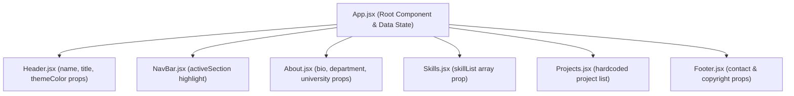

# Practical 1: Introduction to React and Component Architecture

**Course:** Advanced Web Development Frameworks (ITUE301) | Semester: 5th  
**Institution:** Charotar University of Science and Technology (CHARUSAT)  
**Faculty of Technology and Engineering (CSPIT / DEPSTAR)**  
**CO/PO Mapping:** CO1 / PO3, PO5  

---

## 🎯 Objective
To set up a modern React development environment using Vite and build a modular, responsive static UI using independently structured, reusable components and props for data flow.

---

## 🏛️ Component Hierarchy Architecture



---

## 📂 Project Structure

```text
PRACTICAL1/
├── index.html                  # HTML entry point with Google Fonts
├── package.json                # Project dependencies (React 18, Vite)
├── vite.config.js              # Vite bundler configuration
├── .gitignore                  # Node modules and build output exclusions
├── README.md                   # Complete lab documentation and viva prep
└── src/
    ├── main.jsx                # React root mount (ReactDOM.createRoot)
    ├── App.jsx                 # Top-level composition and props distribution
    ├── App.css                 # Layout, card styling, and component themes
    ├── index.css               # Global CSS reset and typography
    └── components/
        ├── Header.jsx          # Header with inline theme gradient prop
        ├── NavBar.jsx          # Nav bar with active section highlight
        ├── About.jsx           # Bio and university department details
        ├── Skills.jsx          # Dynamically mapped skills list
        ├── Projects.jsx        # Project showcase component
        └── Footer.jsx          # Contact email, GitHub profile, copyright
```

---

## 🚀 Getting Started

### 1. Prerequisites
Ensure Node.js (v18+) and npm are installed:
```bash
node -v
npm -v
```

### 2. Installation
Navigate to the `PRACTICAL1` directory and install dependencies:
```bash
cd PRACTICAL1
npm install
```

### 3. Running the Development Server
```bash
npm run dev
```
Open your browser at: `http://localhost:5173`

### 4. Building for Production
```bash
npm run build
npm run preview
```

---

## 💡 Implementation Details

1. **Vite Scaffolding**: Configured using standard React 18 plugin for lightning-fast HMR (Hot Module Replacement).
2. **Reusable Components**:
   - `Header.jsx`: Receives `name`, `title`, and `themeColor`.
   - `NavBar.jsx`: Implements supplementary problem — dynamically highlights the current active section.
   - `About.jsx`: Renders profile bio, department, and university.
   - `Skills.jsx`: Receives `skillList` array as a prop and renders with `map()` and unique keys.
   - `Projects.jsx`: Implements post-lab assignment — showcases 3 featured engineering projects with technology badges.
   - `Footer.jsx`: Receives contact information and renders the dynamic current year.
3. **No Duplication**: Strict single-responsibility principle applied to each component file.

---

## 📋 Viva & Conceptual Questions with Answers

### Q1. What is the role of each component in the overall UI structure?
> **Answer:** Each component encapsulates a single logical unit of user interface and behavior:
> - `Header`: Displays personal branding and identity.
> - `NavBar`: Facilitates smooth internal section navigation.
> - `About`: Summarizes professional bio and university affiliation.
> - `Skills`: Formats technical proficiencies using reusable pill elements.
> - `Projects`: Demonstrates real-world software implementations.
> - `Footer`: Provides persistent contact links and copyright metadata.

### Q2. How does React re-render when props change?
> **Answer:** React creates a Virtual DOM tree representation. When a parent passes new props to a child component, React triggers a reconciliation algorithm (React Fiber). It performs a diffing operation between the old Virtual DOM and the new Virtual DOM, and updates only the specific real DOM nodes that actually changed, avoiding costly full-page reloads.

### Q3. Why is component reusability important in large-scale applications?
> **Answer:** Reusable components ensure:
> 1. **Maintainability**: Bugs or UI updates are modified in one file rather than across hundreds of duplicated locations.
> 2. **Consistency**: Visual design tokens and accessibility attributes remain unified across the product.
> 3. **Testability**: Independent components can be isolated and unit-tested reliably.
> 4. **Velocity**: Teams can assemble new views quickly using an existing design system component library.

---

## 🛠️ Troubleshooting Guide

| Symptom | Likely Cause | Solution |
| :--- | :--- | :--- |
| `npm create vite` hangs | Network proxy or firewall | Check internet connection or run `npm config set registry https://registry.npmjs.org/` |
| Port `5173` already in use | Previous server process still running | Run `npm run dev -- --port 5174` |
| Component not visible | Not imported or not placed in return JSX | Verify `import` statement in `App.jsx` and `<Component />` inside JSX |
| Props show as `undefined` | Prop name mismatch between parent and child | Ensure prop names in `App.jsx` match parameter names in child component |
