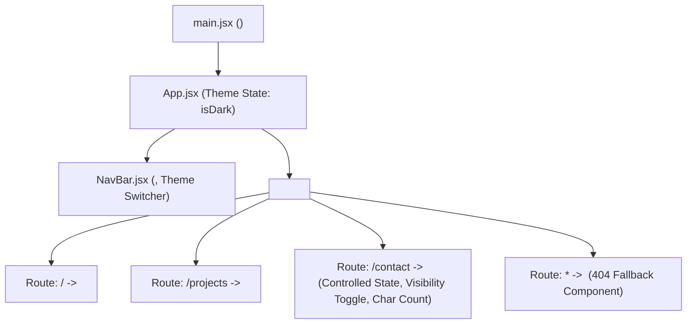

# Practical 2: State Management and Routing in React

**Course:** Advanced Web Development Frameworks (ITUE301) | Semester: 5th  
**Institution:** Charotar University of Science and Technology (CHARUSAT)  
**Faculty of Technology and Engineering (CSPIT / DEPSTAR)**  
**CO/PO Mapping:** CO1 / PO3, PO5  

---

## 🎯 Objective
To implement reactive state management using the `useState` hook and multi-page client-side navigation using React Router (`react-router-dom` v6) without incurring full page browser reloads.

---

## 🏛️ Routing & State Architecture



---

## 📂 Project Structure

```text
PRACTICAL2/
├── index.html                  # HTML entry point
├── package.json                # React 18, React Router DOM v6, Vite
├── vite.config.js              # Vite server & build config
├── .gitignore                  # Node modules & build ignore
├── README.md                   # Full documentation & viva answers
└── src/
    ├── main.jsx                # Wraps <App /> with <BrowserRouter>
    ├── App.jsx                 # Routes declaration & dark/light theme state
    ├── App.css                 # Form, card, and theme layout styling
    ├── index.css               # Theme definitions (.theme-dark / .theme-light)
    ├── components/
    │   ├── NavBar.jsx          # Client-side router links (<NavLink>) & theme trigger
    │   └── Footer.jsx          # Academic attribution footer
    └── pages/
        ├── Home.jsx            # Landing view describing SPA architecture
        ├── Projects.jsx        # Project catalog with category filtering state
        ├── Contact.jsx         # Controlled input, live char count & visibility toggle
        └── NotFound.jsx        # Supplementary 404 custom error route
```

---

## 🚀 Getting Started

### 1. Installation
Navigate to `PRACTICAL2` and install dependencies:
```bash
cd PRACTICAL2
npm install
```

### 2. Start Development Server
```bash
npm run dev
```
Access at `http://localhost:5173`

### 3. Verify Routing & State Features
- Click **Home**, **Projects**, and **Contact** links in the navigation bar. Check the browser Network tab: observe that no page reload occurs and no HTML document is re-fetched.
- Click the **Dark / Light** button in the header: verify the theme toggle modifies state and flips the UI styles instantaneously.
- Go to the **Contact** page:
  - Click **Show Form Guide**: toggles help message visibility.
  - Type inside the message box: observe the live character count updating per keystroke (`x / 250 characters`) alongside the real-time preview box.
- Enter an invalid route (e.g., `http://localhost:5173/unknown`): verify the custom **404 Page Not Found** component renders gracefully.

---

## 📋 Viva & Conceptual Questions with Answers

### Q1. What is the difference between `<Link to="...">` and `<a href="...">`?
> **Answer:** 
> - Standard anchor tags (`<a href="...">`) cause the browser to trigger a full page lifecycle: unloading the current DOM, sending an HTTP GET request to the web server, downloading the entire HTML bundle, and re-initializing the JavaScript runtime.
> - React Router's `<Link>` or `<NavLink>` uses the browser's `history.pushState` API to change the URL path in the address bar without a network round-trip. It then causes React to swap only the matching route component in the Virtual DOM, providing seamless, sub-millisecond transitions.

### Q2. How does React re-render when props or state change?
> **Answer:** 
> Whenever a state updater function (e.g., `setMessage` or `setIsDark`) is called, React schedules a re-render for that component and its descendants. During render execution, React compares the new Virtual DOM output with the snapshot of the previous Virtual DOM (Reconciliation). Only DOM nodes whose attributes or inner contents actually changed are patched in the real browser DOM.

### Q3. Why must form inputs be "controlled" in React?
> **Answer:**
> In uncontrolled inputs, the DOM `<input>` element holds its own internal mutable state, making validation, dynamic formatting, and instant previews cumbersome. In a controlled component, the input's current value is driven by React component state (`value={message}`) and changes are emitted via `onChange={(e) => setMessage(e.target.value)}`. This guarantees a **single source of truth** where React always controls the data flow.

---

## 🛠️ Troubleshooting Guide

| Symptom | Likely Cause | Solution |
| :--- | :--- | :--- |
| Blank page after adding routes | `BrowserRouter` not wrapping `App` | Ensure `<BrowserRouter>` wraps `<App />` inside `main.jsx` |
| Clicking nav link reloads page | Used `<a>` instead of `<Link>` or `<NavLink>` | Replace all anchor elements with `<NavLink to="...">` |
| Form input not updating on typing | Missing `onChange` handler or not calling updater | Bind `value={state}` and `onChange={(e) => setState(e.target.value)}` |
| Route shows wrong component | Route path mismatch or incorrect order | Ensure specific route paths match exact string, and place `path="*"` at the end |
