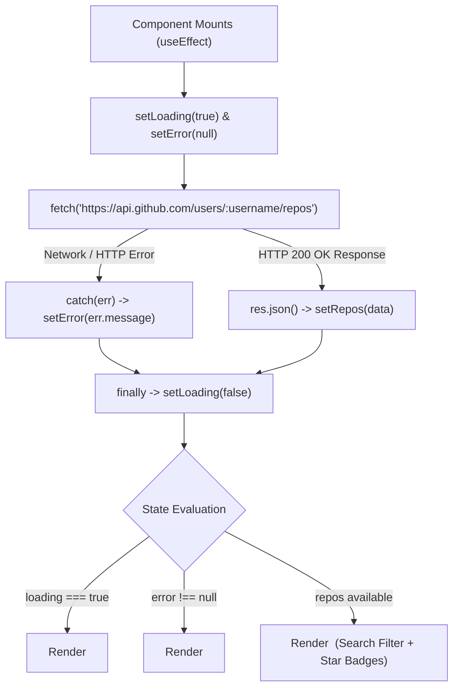

# Practical 3: API Integration and Data Rendering in React

**Course:** Advanced Web Development Frameworks (ITUE301) | Semester: 5th  
**Institution:** Charotar University of Science and Technology (CHARUSAT)  
**Faculty of Technology and Engineering (CSPIT / DEPSTAR)**  
**CO/PO Mapping:** CO1 / PO3, PO5  

---

## 🎯 Objective
To consume a REST API (GitHub Public API) in a React application using `fetch`, and manage asynchronous state transitions (`loading`, `error`, `success`) with conditional UI rendering and error recovery.

---

## 🏛️ Asynchronous Lifecycle Architecture



---

## 📂 Project Structure

```text
PRACTICAL3/
├── index.html                  # HTML entry point
├── package.json                # Project dependencies (React 18, Vite)
├── vite.config.js              # Vite dev server configuration
├── .gitignore                  # Exclusions for node_modules
├── README.md                   # Lab manual, viva questions, troubleshooting
└── src/
    ├── main.jsx                # React root mount
    ├── App.jsx                 # Top-level shell and layout
    ├── App.css                 # Responsive CSS grid, spinners, error alerts
    ├── index.css               # Typography and global reset
    └── components/
        ├── Spinner.jsx         # Custom animated CSS loader
        ├── ErrorMessage.jsx    # Error banner with user-triggered Retry button
        ├── RepoList.jsx        # Repository card grid, stars, and external links
        └── Projects.jsx        # Asynchronous state orchestrator with search filtering
```

---

## 🚀 Getting Started

### 1. Installation
Navigate to `PRACTICAL3` and install dependencies:
```bash
cd PRACTICAL3
npm install
```

### 2. Start Development Server
```bash
npm run dev
```
Open your browser at `http://localhost:5173`.

### 3. Verification & Testing Steps
1. **Happy Path**: On initial load, observe `<Spinner />` appear while repositories are fetched from `api.github.com/users/facebook/repos`. Once resolved, the repository cards render with stars and metadata.
2. **Search Filter**: Type into the search input (e.g. `react` or `flux`) to see repositories filter dynamically in real-time.
3. **Error Path Simulation**: Click the **Simulate Error** button (fetches a non-existent account). Observe:
   - Spinner displays during request.
   - `<ErrorMessage />` replaces the list, showing the exact HTTP 404 message.
   - Click **Retry Request** to re-trigger the fetch cleanly.

---

## 📋 Viva & Conceptual Questions with Answers

### Q1. Why is `useEffect` required to trigger a fetch on component mount instead of calling `fetch` directly in the component body?
> **Answer:** 
> In React, the component function body is executed on **every single render cycle**. If a side effect like `fetch()` is placed directly in the body, updating the component's state (`setRepos(data)`) causes another render, which executes `fetch()` again, triggering an **infinite network loop** that exhausts browser resources and triggers API rate limits. `useEffect` with an empty dependency array `[]` instructs React to execute the asynchronous side effect **only once**, after the component has initially mounted into the DOM.

### Q2. What is the difference between a loading state and an error state, and why must both be handled separately?
> **Answer:** 
> - **Loading State**: Indicates that an asynchronous network request is currently in flight. It provides visual feedback (e.g. spinner, skeleton) so the user understands the application is active and waiting for server response.
> - **Error State**: Indicates that the asynchronous request terminated abnormally (e.g., DNS failure, HTTP 404, rate limit 403, or 500 server crash).
> 
> They must be handled separately because conflating them leaves the user in an ambiguous state (e.g., displaying a permanent frozen spinner when a network disconnects, or showing "No data found" when a real network failure occurred).

### Q3. How would the user experience change if loading and error states were not implemented?
> **Answer:**
> Without loading states, the user experiences an unresponsive UI (frozen screen, apparent lag, or empty white space) with no clue whether the app has hung. Without error states, failures fail silently; the user cannot distinguish between an empty result set and a broken network connection, and is offered no path for recovery (such as a Retry action).

---

## 🛠️ Troubleshooting Guide

| Symptom | Likely Cause | Solution |
| :--- | :--- | :--- |
| Infinite network requests in console | Missing dependency array `[]` in `useEffect` | Provide an empty dependency array `[]` as the second argument to `useEffect` |
| Spinner never disappears | `setLoading(false)` not called in error/finally blocks | Place `setLoading(false)` inside a `.finally()` block or ensure both `try` and `catch` clear it |
| App crashes on API failure | Trying to call `.map()` on `undefined` | Ensure initial state is `[]` and verify data is an array before setting state |
| HTTP 403 Forbidden | GitHub API unauthenticated rate limit reached (60 req/hr) | Wait for limit to reset, or switch targets using the demo switcher |
